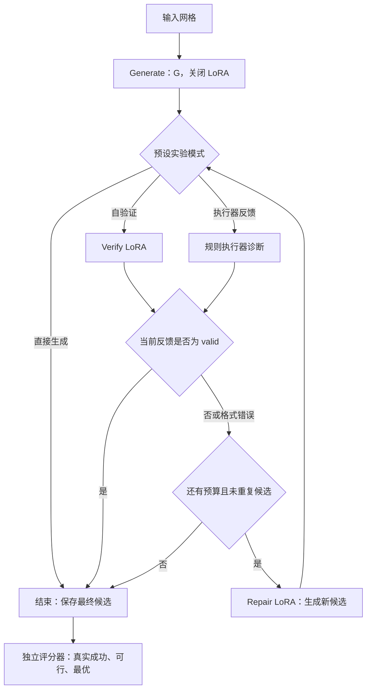

# Project 6：全参数生成＋LoRA 验证修复＋轻量 Harness 计划

> 日期：2026-10-29。状态：P1–P3 代码与评测入口已实施，CPU 测试通过；P0 证据不齐，尚未实施新训练或产生新成绩。依据课程说明、用户方案及仓库 `main@b433523d6898`。历史成绩来自仓库文档，未重新运行；权重、完整 GPU 账本和逐条实验结果尚需从原实验环境核实。实施状态与命令见 [GVR 协议](docs/gvr_protocol.md)。

## 1. 目标与当前基础

**目标：保留已有基线，新增“Generate 全参数微调，Verify／Repair 独立 LoRA”的固定工作流，研究反馈能否提高验证、修复和端到端规划效果。**

| 当前资产 | 已有实现／文档记录 | 本计划如何使用 |
|---|---|---|
| 两个原始基线 | Flan-T5-small、BART-base，均为生成／验证／修复共享全参数微调；开发集选出 Flan-T5-small | 保留双模型同预算比较与原始结果 |
| 三个后续训练候选 | Flan-T5-small v2、v3 single、v3 multi，均为全参数微调；v3 multi 被选中。v2 reference 复用旧权重 | 作为已有扩展实验，不重复训练 |
| 逐步规划 | v3 无搜索成功率 85%；合法未访问约束 97.5%；神经 A* 和纯 A* 均可达 100% | 单独报告，不能替代验证／修复指标 |
| 当前优先 Harness | v3 multi 逐步评分＋合法动作过滤＋最少访问次数优先；固定 Python 控制器 | 复用预算、日志、恢复能力 |
| Harness 对照 | 同 200 个 ID 网格、16 次请求上限：关闭访问次数约束 85%，开启 99.5%，后者最优率 86.5% | 说明程序约束的效果，不能当作 LoRA 或模型验证成绩 |
| 最终交付 | 仓库文档称实验已完成，正式报告与展示材料待整理 | 补齐证据、至少两个真实修复案例及课程报告 |

当前逐步 Harness 的模型后端只做动作评分，没有执行学习式 Verify→Repair 循环。新方案补上这条研究主线。[现有项目说明](https://github.com/Xiaofeipao/NLP-Project/blob/b433523d689844bb00861cab54ea481149f7b03e/README.md)

## 2. 训练结构：一个生成底座，两个独立适配器

```text
固定版本的预训练 Flan-T5-small
          │ 仅使用 Generate 子集，全参数微调
          ▼
生成模型 G（选定后冻结）
          ├─ 关闭全部适配器 → Generate：地图 → 完整路径
          ├─ 启用 Verify LoRA → 地图＋候选 → valid／首错步骤与原因
          └─ 启用 Repair LoRA → 地图＋候选＋反馈 → 修正后的完整路径
```

- G 从同版本预训练权重开始；旧三任务 checkpoint 作为基线，不能直接改名为“仅生成训练的 G”。
- 两个适配器分别从同一份冻结 G 开始训练，不叠加训练，也不更新另一个适配器；推理时一次只启用对应适配器。
- 首轮保留完整路径输出和既有文本交叉熵目标，不同时引入逐步动作、前缀修复或新提示表示。
- 起始 LoRA 配置建议：`SEQ_2_SEQ_LM`、T5 注意力 `q/v`、`r=8`、`alpha=16`、`dropout=0.05`、`bias=none`。这是待开发集验证的起点；先核实实际模块匹配及可训练参数。
- 沿用 seed 42、batch 8、梯度累积 2；以两轮为初始预算。学习率从现有 `1e-4` 起步，调整只看开发集；不大范围搜索。
- 选定 G 后记录其哈希，再训练两个 LoRA；适配器必须绑定 G 的权重哈希。关闭适配器时，输出应与原 G 一致。
- 现有 Transformers 为 `4.57.6`：实施时选择并锁定兼容 PEFT 版本，不直接照搬最新文档升级整个环境。PEFT 支持多个命名适配器与按任务切换。[官方参考](https://huggingface.co/docs/peft/main/en/quicktour)

**待验证假设：**任务独立适配能否减少干扰，并以更少的可训练参数保持或改善验证／修复。LoRA 不保证优于全参数微调；仅用 800 条样本训练 G 也可能损失原多任务训练的迁移收益。

## 3. 数据与课程限制：先固定配额，再考虑调整

| 任务 | 首轮训练样本 | 固定开发样本 | 监督内容 |
|---|---:|---:|---|
| Generate | 800 | 40 | 网格描述 → 正确路径 |
| Verify | 2,000 | 100 | 有效性＋首次错误位置＋错误类型 |
| Repair | 1,200 | 60 | 单错误候选＋执行器反馈 → 正确路径 |
| 合计 | **4,000** | **200** | 不增添额外训练样本 |

1. 保留按障碍布局划分的数据及 ID；ID／OOD 各 200 条，网格配对。有效样本含最优和可行非最优路径；非法训练与 ID 候选含单错误，OOD 非法候选含两个独立错误。
2. 首轮只比较结构。`1,600／1,200／1,200` 是后续可选配额，不是已确定最优方案；不能同时改结构和配额，再把改善归因于 LoRA。
3. 配额调整须在训练布局内替换记录，保存内容哈希和来源映射。生成多个版本各自≤4,000，并不自动说明累计不同训练样例符合课程总额；实施前核对统计口径。
4. 自然生成错误可用于分析；加入训练时仍需满足单错误、样本总额和环境隔离。测试失败不能回流训练，多错误生成轨迹不能无筛选加入必做训练集。
5. 固定一个随机种子；每个适用训练子集最多三轮。pilot、正式训练和续训逐项记账，换适配器不能视为自动重置额度。独立新方案应披露每阶段遍历次数及所有候选总成本。
6. 全项目共用 20 GPU 小时上限，已有基线、后续训练、pilot 和评测都要累计；CPU 数据构造单独记录。先取得完整账本，不用早期基线耗时估计余额。
7. 开始新训练前核实负责人对 Flan-T5 checkpoint 的确认记录；配置中的用户确认不能自动证明已满足课程的负责人确认要求。

约束来源：[Project 6 中文说明](D:/xwechat_files/wxid_rw70bq3nv72c22_00fd/msg/file/2026-10/Project_6_完整中文翻译.md)。

## 4. Harness：用显式状态机管理固定工作流

采用“生成→评价→修复”的有限循环。任务步骤已知，Python 控制器即可管理，无需另加调度大模型。该设计借鉴固定工作流与 evaluator–optimizer 模式，只借鉴结构，不引入外部 Agent 框架。[设计参考](https://www.anthropic.com/research/building-effective-agents)



**模型、控制器、评分器各自负责什么：**

- 模型只返回路径或原有验证格式；控制器解析并选择适配器，不要求小模型原生生成工具调用 JSON。
- 控制器保存 `candidate`、原始反馈、反馈来源、修复轮数、调用量、候选历史和停止原因。整路径提案始终从同一起点验证，失败提案不改变已提交环境位置。
- 自验证分支只接收模型反馈。执行器真值、真实失败位置、合法前缀和 BFS 答案均不能用于其修复或提前停止。模型误判 `valid` 可以导致真实失败，评分时如实记录。
- 执行器分支可使用真实诊断；首轮只使用现有步骤／原因格式，使反馈来源对照尽量一致。位置、合法前缀等增强信息留给独立扩展实验。
- 验证输出格式错误时保留原文并触发预算内修复，不替换成正确执行器反馈。停止条件预先固定：反馈 `valid`、候选重复、轮数／调用／时间预算耗尽。
- 最终评分器只评最后返回的候选，不从历史中借助真值挑最优输出；失败样本和格式错误均留在指标分母。
- 复用现有追加日志、原子快照、锁与恢复；模型调用前计账。记录底座＋适配器身份，防止恢复时切错模型。时间预算在调用边界检查，不宣称是可抢占硬超时。

**成本口径：**每次 Generate／Verify／Repair 都计模型调用；执行器调用单独计数，另报输入输出 token、实际前向计算、耗时和显存。相同轮数不代表相同计算量。首轮不把旧版 16 次逐步动作预算直接套到整路径流程。

## 5. 最小实验矩阵与指标

新方案只在开发集选定的 Flan-T5-small 上进行，保留原 Flan-T5-small／BART-base 匹配预算基线；不要求为 BART 再训练两套 LoRA。

| 实验 | 固定部分／变化部分 | 用途 |
|---|---|---|
| A：原三任务全参数基线 | 历史配置和冻结结果 | 原始参照，先核实产物 |
| B1：G 直接生成 | 新方案的同一 G | 测量初始规划能力 |
| B2：G→Verify LoRA→Repair LoRA，至多一次修复 | 固定 G 和 Repair LoRA，使用模型反馈 | 必做自验证对照 |
| B3：G→执行器→Repair LoRA，至多一次修复 | 与 B2 使用同一初始候选，切换反馈来源 | 必做执行器反馈对照 |
| B4：执行器反馈，最多三次修复 | 与 B3 相同权重和第一轮输出，只增加轮数 | 迭代改进；B3 是移除迭代的消融 |
| C：可选全参数任务分支 | 从相同 G 分别复制并全参数训练 V／R，使用相同子集和遍历预算 | 分离“任务拆分”和“LoRA”的影响 |

- 单独在固定 ID／OOD 候选上评 Verify 和 Repair，不让生成器质量掩盖这两项能力；再用 G 的真实输出做端到端比较。
- 必报：成功率、可行率、最优率、验证 Macro-F1、首错定位准确率、修复成功率、端到端成功率；按错误类型分组并记录各组样本数。
- ID／OOD 共享网格，因此直接生成指标不能包装成两次不同环境泛化；必做 OOD 结论来自双错误候选验证／修复。
- Repair 首轮用真实反馈训练，自验证使用模型反馈；专门报告这个反馈分布差异。
- A 与 B 同时改变任务拆分和训练方式，不能单凭 A/B 宣称“LoRA 导致提升”；C 未做时明确该归因限制。
- B4 比 B3 使用更多推理计算，报告增益与额外成本；同预算反馈比较应另设统一调用上限并明确两类调用成本。
- 模型与配置选择只看开发集。旧测试集已多轮使用，后续结果属于复用测试集评估，不宣称全新盲测。

## 6. 实施顺序与文件边界

| 顺序 | 工作与主要文件 | 阶段产物／完成条件 |
|---|---|---|
| P0：核实已有实验 | 原实验 `outputs/`、数据 manifest、GPU ledger、checkpoint 确认记录 | 基线证据、剩余预算、数据版本及缺失项清单；证据未齐不启动昂贵训练 |
| P1：固定数据与协议 | `ppnl/data.py`；新增任务索引和配置 | 原 4,000 条按任务索引读取；布局隔离、ID／OOD 不变；记录样本曝光预算 |
| P2：实现模型路由 | `ppnl/modeling.py`；新增 `ppnl/task_adapters.py`、训练入口 | G 全参数训练；V／R 独立 LoRA；锁定依赖并验证底座冻结、单适配器更新、保存重载与关闭适配器一致性 |
| P3：接入固定循环 | 复用 `ppnl/harness.py` 持久化组件；新增 `ppnl/gvr_harness.py` 与配置 | 三种模式、迭代、停止及恢复行为明确；用替身模型检查自验证无真值泄漏 |
| P4：训练与开发选择 | 新独立输出目录；复用 GPU 账本 | 先选并冻结 G，再分别训练 V／R；记录可训练参数、显存、吞吐和模型哈希 |
| P5：评测和交付 | 扩展 `ppnl/evaluation.py`，新评测入口及汇总 | B1–B4、候选 ID／OOD、完整指标、真实案例、报告和展示材料 |

复用 `core.py` 执行语义、`prompts.py` 任务模板及既有指标。现有 `submit_plan` 会调用执行器并以真值决定提交，**不能直接充当自验证分支的停止逻辑**；新工作流需要“结束并交给独立评分”的接口。

项目源码已从 GitHub `main@b433523` 接入当前工作区。原实验产物仍缺失；本文件中的 P4／P5 实际训练、成绩与报告仍属待完成工作。

## 7. 验收与后续优先级

- [ ] 明确区分历史已报告结果、新方案实际结果和未验证假设。
- [ ] 保留两个原始模型基线；新方案有直接生成、自验证、执行器反馈、ID／OOD 和一次聚焦消融。
- [ ] 数据不超额、不跨环境泄漏；全部训练与推理预算可追溯。
- [ ] G 冻结后不被 LoRA 训练修改；适配器独立、任务切换正确、恢复身份一致。
- [ ] 自验证分支没有执行器信息泄漏，所有失败进入统计。
- [ ] 报告包含摘要、引言、相关工作、方法、设置、结果、错误分析、消融和结论；至少两个真实修复案例。

**首轮只完成原配额＋新训练结构＋固定 Harness。** 完成后按开发集问题选择一个后续方向：配额重分配、执行器反馈下的前缀保留修复、或实际单错误样本替换。逐步策略和 A* 保留为独立扩展对照，避免同时更换生成方式、修复方式和数据而失去可解释性。

### 资料与证据

- [仓库固定版本](https://github.com/Xiaofeipao/NLP-Project/tree/b433523d689844bb00861cab54ea481149f7b03e)：代码、配置及历史实验说明；原始输出需另外核实。
- [现有 Harness](https://github.com/Xiaofeipao/NLP-Project/blob/b433523d689844bb00861cab54ea481149f7b03e/docs/harness.md)：逐步策略、恢复机制、预算与结果口径。
- [Anthropic：Building effective agents](https://www.anthropic.com/research/building-effective-agents)：借鉴固定工作流和评价—改进循环的设计思想，不复制代码。
- [PEFT Quicktour](https://huggingface.co/docs/peft/main/en/quicktour)、[LoRA 概念](https://huggingface.co/docs/peft/main/en/conceptual_guides/lora)：适配器训练与切换依据，具体 API 以锁定版本为准。

外部资料访问日期：2026-10-29。研究与架构规划路线（S2，Research-only）；本次交付为计划 Markdown。
