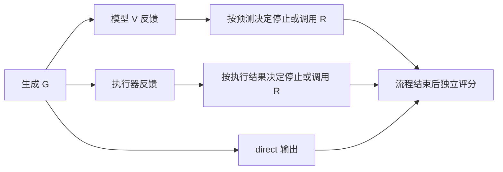

# Project 6 按项目要求整理的设计、实现与结果

本文按照《Project_6_完整中文翻译.md》的顺序，把课程要求对应到仓库的实际设计和实验。核对日期为 2026-11-12。正文以两模型基线、G／V／R 和执行约束修复 C4 为主要研究内容，随后说明逐步 Agent、前缀修复和回溯消融对结论的补充。每项方法同时交代输入、调用的模型任务、执行器职责和结果。

本轮代码整理将固定多任务权重后的 13 项处理统一为配置驱动的配对实验；设计与命令见 [后处理说明](post_training.md)，最新台式机实跑见 [复跑报告](post_training_run_20261112.md)。本文下列历史数值保留各自来源，不覆盖为新结果。

目录

1. [项目说明](#1-项目说明)
2. [实验设置](#2-实验设置)
3. [第一部分　复现基本算法](#3-第一部分复现基本算法)
4. [第二部分　修改核心模块或推理方案](#4-第二部分修改核心模块或推理方案)
5. [第三部分　报告与展示](#5-第三部分报告与展示)
6. [相关工作](#6-相关工作)
7. [GPU 使用与复现条件](#7-gpu-使用与复现条件)

## 1. 项目说明

项目研究小型编码器—解码器语言模型在 6×6 单目标网格中生成、诊断和修复路径的能力。模型读取自然语言网格描述，输出空白分隔的 `up down left right`。课程的核心问题是：**验证与反馈能否改善规划成功率和可行率，单错误训练能否迁移到双错误候选？**

对应的实验顺序是先建立两模型 G／V／R 基线，由开发集选出主模型，再检查实际失败，比较模型自验证与执行器反馈，最后加入修复改进和消融。主要改进使用历史主模型的 R 做约束解码，逐步 Agent 和前缀方法提供另一种恢复方式的对照。此前 poster 的训练规模、网格条件和提示实验另有说明，引用其结果时需要标注原实验设置。[Poster 对照导览](poster_guide.md)

## 2. 实验设置

### 2.1 数据和错误构造

课程要求单目标 6×6、按环境隔离、同时保留最优与合法非最优路径，并构造 ID 单错误和 OOD 双错误候选。仓库固定 PPNL 上游版本 `5fd0376`，合并来源后按**障碍物布局**重新划分，确保同一布局的所有起终点组合处于同一训练／开发／测试分区。不可达及最短路不足两步的环境被过滤。最短路由 BFS 构造并与官方执行语义核对，非最优有效路径由合法往返动作构成。[数据说明](../data/README.md) · [构造协议](experiment_protocol.md#数据和错误)

| 划分 | 总样本数 | 用途 |
| --- | ---: | --- |
| 训练 | 4,000 | G 800、V 2,000、R 1,200，三任务合计配额 |
| 开发 | 200 | G 40、V 100、R 60，供训练／方法选择 |
| ID 测试 | 200 | 100 条合法控制、100 条单错误候选 |
| OOD 测试 | 200 | 100 条合法控制、100 条双错误候选 |

ID/OOD 的网格、起点和终点配对，改变的是预置候选的错误数量。候选验证／修复因此能检验错误数量迁移。从零生成及从 G 输出开始的修复使用同一批 200 个规划环境，两个 split 的端到端结果只提供一组地图证据。

错误注入包括动作替换、删除、插入、提前停止和未知动作词。ID 的提前停止按一次截断记录，可能删除多步。OOD 在两个不同原始位置独立操作，要求最终 token 编辑距离为 2，并剔除操作相互抵消或仍然成功的负例。**注入操作**与下面的**执行失败类型**分别记录，因为两次注入可能只暴露一个首错。[数据构造实现](../ppnl/data.py)

### 2.2 G、V、R、执行器与真实标签

| 角色 | 输入 | 输出和用途 |
| --- | --- | --- |
| G 生成任务 | 网格自然语言描述 | 一整条候选动作序列 |
| V 验证任务 | 网格＋候选 | 模型预测的 `valid` 或首错诊断 |
| R 修复任务 | 网格＋候选＋反馈文本 | 重新生成整条动作序列 |
| 本地严格执行器 | 网格＋动作序列 | 确定性的成功／可行判定、首错步、原因和轨迹 |
| `OfficialOracle.check` | 同一网格和路径 | 计算本地判定，并对合法动作序列调用官方 `is_goal` 核对成功／碰撞语义 |

验证标签为 `valid`，或者 `invalid | step=<index> | reason=<error_type>`。这里的 `valid` 要求整条路径合法且最终到达目标。只有动作合法、但停在目标外的路径属于 **feasible 且 invalid**。本地执行器逐步产生详细标签，官方 `is_goal` 不能完整提供四类原因和首错位置，且会忽略未知词。本项目的严格动作词表检查是明确记录的扩展。[执行器实现](../ppnl/core.py)

| 首错类型 | 判定 | 首错步，均从 1 开始 | Feasible |
| --- | --- | --- | --- |
| `obstacle_collision` | 下一格是障碍 | 发生碰撞的动作步 | 0 |
| `out_of_bounds` | 下一格越出边界 | 越界动作步 | 0 |
| `invalid_action_token` | 当前 token 不属于四动作，如 `jump` | 该 token 的位置 | 0 |
| `goal_not_reached` | 全部动作合法，但最后位置未达目标 | 动作数＋1，即 EOS | 1 |

执行器在最早失败处停止。例如先撞墙、后出现未知词，标签报告撞墙。空路径且起终点不同，失败步为第 1 步 EOS。

**固定候选测试分别评 V 和 R。** V 的预测用于验证指标，而 R 实际收到数据行 `label` 中的执行器金标。这测量给定正确诊断的候选修复能力。端到端 `self` 才把模型 V 的预测文本传给 R，具体流程见 4.2。[早期评分实现](../ppnl/evaluation.py) · [GVR 评分实现](../ppnl/gvr_evaluation.py)

以上为历史独立 R 基线口径。本轮候选表也比较 `self` 的模型反馈，以及 `none/generic` 反馈删减；各方法的实际输入见 [统一后处理说明](post_training.md#3-v执行器与-r-的边界)。

### 2.3 指标和分母

设被评估的最终路径数为 `N`，输出动作数为 `L`，BFS 最短动作数为 `L*`。生成与修复都报告以下三项路径指标。[指标实现](../ppnl/evaluation.py)

| 指标 | 定义 |
| --- | --- |
| Success rate | 整条路径合法且最后位置为目标的条数／`N` |
| Feasibility | 所有动作合法且没有越界／碰撞的条数／`N`，允许未到目标 |
| Optimality | 成功且 `L = L*` 的条数／`N` |
| Repair success rate | 修复后成功的金标无效候选数／全部金标无效候选数，测试分母为 100 |
| End-to-end success | 从 G 开始的完整流程最终成功环境数／参与流程的唯一环境数，测试分母为 200 |
| 验证 Macro-F1 | 固定 valid／invalid 两类的 F1 平均，格式错误计为对应真类漏报 |
| 首错定位准确率 | 预测 invalid 且步号正确的数量／全部金标无效候选数 |

补充诊断包含输出格式准确率、首错类型准确率、步号与类型联合准确率，以及成功样本上 `L*/L` 的平均。无样本或没有成功路径时，相应平均值记为 `null`。错误分组指标按候选**实际首错**计算，保留每组分母。

例如起点 `(0,0)`、目标 `(0,2)` 的无障碍网格中，`right` 为可行但失败，`right right` 为成功且最优，`down right right up` 为成功但非最优。因此 feasibility、success、optimality 逐层增加要求。在 100 合法＋100 无效的平衡候选上全部预测 `valid`，格式准确率可以是 100%，Macro-F1 只有 1/3，首错定位为 0。

## 3. 第一部分：复现基本算法

### 3.1 两模型基线和开发集选择

早期课程主线使用 `google/flan-t5-small` 与 `facebook/bart-base`，各训练一个共享 G／V／R 的多任务 checkpoint。二者都使用同一 4,000 条记录、两轮训练、seed 42、FP32、batch 8、梯度累积 2、学习率 `1e-4`，各处理 8,000 次样本并更新 500 次。推理使用贪心解码，允许重复动作。准确模型 revision 固定在配置中。[配置](../config.json) · [正式运行记录](https://github.com/Xiaofeipao/NLP-Project/blob/23183e2/README.md#正式实验已完成)

各模型先以开发集 token 平均 loss 选择 epoch，再以开发集生成成功率、V Macro-F1、金标反馈下 R 成功率的均值选择主模型。综合分数 Flan-T5-small 为 **0.2897**，BART-base 为 **0.2374**，后续课程主线选 Flan-T5-small。历史基线实际在开发集 100 条验证候选上计算 V，修复其中 50 条无效候选，并对去重后的 98 个环境评 G。后续独立 GVR 与 C4 使用 G 40／V 100／R 60 的任务配额，其开发成绩需按各自分母阅读。[历史开发指标](../artifacts/historical_models/flan_t5_small/eval_dev/metrics.json)

### 3.2 同一 ID 测试上的基线结果

V 在 200 条候选上评测，首错定位分母为其中 100 条无效候选。R 接收金标反馈并修复这 100 条无效候选。下表路径百分比按 `success / feasibility / optimality` 排列，G 的分母为 200 个环境。

| 基线 | V Macro-F1 | 首错定位 | 固定候选 R 一次 | G 直接生成 |
| --- | ---: | ---: | --- | --- |
| Flan-T5-small | 0.7141 | 8% | 19% / 46% / 19% | 0% / 0% / 0% |
| BART-base | 0.7246 | 45% | 10% / 34% / 10% | 0% / 10.5% / 0% |

BART 的首错定位更高，Flan 的候选修复成功率更高。两者从零生成均未成功。开发集选出的 Flan 继续承担完整流程与改进研究。[Flan 原始指标](../artifacts/historical_models/flan_t5_small/eval_test_id/metrics.json) · [BART 原始指标](../artifacts/historical_models/bart_base/eval_test_id/metrics.json)

后续还运行了普通 `google-t5/t5-small`、`google-t5/t5-base` 和 BART 的扩展实验。它们有独立的训练配置和结果，本文在解释 Agent／前缀对照时注明其来源，完整矩阵保留在原报告。[三模型扩展](gpu_campaign_20261103.md)

## 4. 第二部分：修改核心模块或推理方案

### 4.1 调查失败案例

主模型 Flan 的候选验证与修复呈现不同的薄弱点。下表取自早期主线，定位及修复的分母均为该首错类型全部无效候选，R 使用正确金标反馈。

| 首错类型 | ID 数量 | ID 定位正确 | ID 一次修复成功 | OOD 数量 | OOD 定位正确 | OOD 一次修复成功 |
| --- | ---: | ---: | ---: | ---: | ---: | ---: |
| `goal_not_reached` | 58 | 7/58 | 10/58 | 30 | 4/30 | 0/30 |
| `invalid_action_token` | 20 | 1/20 | 6/20 | 45 | 13/45 | 4/45 |
| `obstacle_collision` | 14 | 0/14 | 1/14 | 14 | 3/14 | 2/14 |
| `out_of_bounds` | 8 | 0/8 | 2/8 | 11 | 0/11 | 1/11 |

每组另外包含 100 条合法控制，用于 valid／invalid 分类。ID 的碰撞和越界定位均为 0，OOD 中合法但未达目标的候选一次修复成功数为 0/30。[ID 逐类指标](../artifacts/historical_models/flan_t5_small/eval_test_id_full/metrics.json) · [OOD 逐类指标](../artifacts/historical_models/flan_t5_small/eval_test_ood_full/metrics.json)

以下两例保留完整网格参数与每轮结果，均来自同一主模型的固定候选测试。坐标为从 0 开始的 `(行,列)`，给定 6×6 尺寸、起终点与全部障碍坐标即可重建网格。[案例原始轨迹](../artifacts/historical_models/flan_t5_small/eval_test_id_full/case_studies.json)

**案例 A，`test_id-1`。** 起点 `(3,4)`、目标 `(2,5)`、障碍 `(2,1),(2,2),(3,2)`，最短路为 `up right`。候选 `down right` 依次到 `(4,4)`、`(4,5)`，在第 3 步 EOS 触发 `goal_not_reached`。V 预测相同原因，但把步号报成 2。实际 R 收到第 3 步的金标反馈。

| 阶段 | 完整输出 | 执行结果 |
| --- | --- | --- |
| 原候选 | `down right` | 可行但未达目标，首错为 EOS 第 3 步 |
| 修复第 1 轮 | `down right right right` | 第 3 步从 `(4,5)` 向右到 `(4,6)`，越界 |
| 修复第 2 轮 | `down right right right right` | 第 3 步仍越界 |
| 修复第 3 轮 | `down right right right right right right` | 第 3 步仍越界 |

原候选的 feasibility 为 1，最终三项路径指标均为 0。R 在正确反馈下引入了新的物理错误，继续增加轮数也未修正。

**案例 B，`test_id-7`。** 起点 `(3,4)`、目标 `(3,2)`、障碍 `(0,1),(1,1),(2,3),(3,0),(5,2)`，最短路为 `left left`。原候选 `left` 到 `(3,3)` 后停止，金标为 `invalid | step=2 | reason=goal_not_reached`，V 将步号报成 1。R 接收第 2 步的金标，第 1 轮输出 `left left`，经 `(3,3)` 到目标 `(3,2)`，执行器返回 `valid` 并停止。修复前 `success / feasibility / optimality` 为 `0 / 1 / 0`，修复后为 `1 / 1 / 1`。这个成功属于正确反馈条件下的 R，V 的错误预测仅参与独立验证评分。

### 4.2 实现生成—验证—修复流程

课程要求比较直接生成、模型自验证和执行器反馈。当前整路径 Harness 使用以下四种模式，输入起点都是 G 生成的同一候选。

| 模式 | 反馈和模型调用 | 修复与停止 |
| --- | --- | --- |
| `direct` | 只调用 G | 生成后结束，独立计分 |
| `self` | G → V，V 原始文本供 R 使用 | V 解析为 `valid` 就停止，否则最多修复一次。格式错误反馈也触发修复 |
| `executor_one` | G → 本地严格执行器 → R | 初始路径失败才修复，最多一次 |
| `executor_three` | G → 本地严格执行器 → R → 再执行 | 成功则停止，最多三次修复 |

执行器分支跳过学习式 V。`self` 的决策只读取模型反馈，最终执行真值在流程停止后用于评分和统计 `false_valid_accept`。这一设计允许检验 V 的错误放行是否阻断 R。旧批量实现位于 `evaluation.py`，当前可恢复控制器位于 `gvr_harness.py`。[早期流程](../ppnl/evaluation.py) · [GVR Harness](../ppnl/gvr_harness.py)

GVR Harness 把 `generate → feedback → decide → repair` 写成可恢复状态机。`feedback` 在 self 中调用 V，在 executor 模式中调用本地执行器。重复候选、修复上限或调用／时间预算会停止流程。当前 self 在 R 后可再次调用 V，重复候选等停止条件可能提前结束。日志保存候选、反馈来源和调用数，恢复时核对模型身份。

**全量微调与独立 LoRA 共用这套控制器。** 全量版以任务提示调用同一多任务 checkpoint。独立版先用 800 条 G 样本训练生成底座，再冻结底座，用 2,000 条 V 样本、1,200 条 R 样本训练两套注意力 LoRA。G 推理关闭 adapter，V/R 推理启用对应 adapter。这是两种模型配置，其训练内容和权重差异需要随结果注明。[全量适配](../ppnl/full_finetune_gvr.py) · [任务 adapter 切换](../ppnl/task_adapters.py) · [LoRA 协议](gvr_protocol.md)

早期主模型的 ID/OOD 各四种端到端模式，success、feasibility、optimality 均为 **0%**。独立 LoRA 的初版与后续候选也均为 **0/200**。后续 LoRA 候选的 ID／OOD V Macro-F1 为 **0.6499／0.7326**，金标反馈候选修复为 **12%／4%**，但 self 对 ID 的 200 条 G 失败输出全部错误放行，R 因此被跳过。这暴露了固定候选诊断向实际生成错误迁移的困难。[早期 ID](../artifacts/historical_models/flan_t5_small/eval_test_id_full/metrics.json) · [早期 OOD](../artifacts/historical_models/flan_t5_small/eval_test_ood_full/metrics.json) · [独立 GVR 结果](gvr_next_run.md)

### 4.3 改进、消融与 ID/OOD 结果

#### 改进一　执行器引导的迭代修复

最初的改进是在相同 Flan checkpoint 上，把执行器反馈修复从一次增到最多三次。每轮重新执行当前候选，成功路径保持原输出。一轮版本作为去掉重复修复的消融。下面是 100 条无效候选上的 `success / feasibility / optimality`，模型权重和数据相同，三轮允许更多推理。

| 修复方式 | ID | OOD |
| --- | --- | --- |
| 一次修复 | 19% / 46% / 19% | 7% / 45% / 7% |
| 最多三次 | 19% / 31% / 19% | 11% / 25% / 11% |

OOD 多成功 4 条，但可行率下降 20 个百分点。从 G 开始的端到端仍为 0%，所以后续设计进一步介入 R 的动作解码。[迭代协议](experiment_protocol.md#改进与消融) · [主模型原始结果](../artifacts/historical_models/flan_t5_small/eval_test_ood_full/metrics.json)

#### 改进二　C4 执行状态约束解码

C4 使用同一历史 Flan 多任务权重，仅改变执行器反馈分支中 R 的解码。原始网格、完整坏候选和执行反馈共同进入 R 提示，R 从网格原起点重新生成完整路径。每个 beam 保存动作前缀、当前位置、访问集合和累计模型对数概率，宽度为 4，最多 36 个动作。

每次扩展时，模型给动作／EOS 评分，控制器过滤越界、障碍和路径内回访，到目标才允许 EOS，并停止继续移动。若没有完整解，返回带停止原因的合法部分路径供最终评分。**执行约束进入了逐动作生成过程**，从而减少 R 再次生成非法计划。代码中的约束动作评分适配限 T5 系列。[约束解码](../ppnl/constrained_decoding.py) · [R 模型适配](../ppnl/full_finetune_gvr.py)

| 对照 | 保留和改变的部分 | 回答的问题 |
| --- | --- | --- |
| E1 | 原普通解码，一次执行器反馈修复 | 原始反馈修复水平 |
| B4 | 同 R 模型、beam 宽度、动作上限和动作词表，关闭状态约束 | 状态约束增加了多少收益 |
| C4 | R 模型排序＋合法移动、位置去重、目标 EOS 约束 | 约束解码的系统效果 |
| U4 | 同约束，以固定动作顺序替换模型排序 | 固定规则能达到什么水平 |
| H4 | 同约束，以曼哈顿规则排序，并偏向短解 | 强规则对照的成功率和路径质量 |

开发集上 C4 从 G 开始成功 **36/40**，固定候选修复 **60/60**，随后冻结设置。测试各方法共用初始 G 输出，一次修复。ID/OOD 的端到端复用相同 200 个网格，候选修复各用 100 条对应错误分布的无效候选。下表统一列 `success / feasibility / optimality`。

| 方法 | 从 G 开始，200 环境 | ID 候选修复，100 条 | OOD 候选修复，100 条 |
| --- | --- | --- | --- |
| E1 | 0% / 0% / 0% | 19% / 46% / 19% | 7% / 45% / 7% |
| B4 | 0% / 0% / 0% | 25% / 56% / 25% | 8% / 51% / 8% |
| **C4** | **92% / 100% / 43%** | **98% / 100% / 96%** | **94% / 100% / 83%** |
| U4 | 95.5% / 100% / 37% | 95% / 100% / 35% | 95% / 100% / 35% |
| H4 | 100% / 100% / 99.5% | 100% / 100% / 99% | 100% / 100% / 99% |

本轮沿用旧 V，另行测得 ID／OOD Macro-F1 **0.7190／0.7750**、首错定位 **8%／20%**。这是 C4 研究运行中的实测值，早期主线对应值为 0.7141／0.7700，应保留各自运行记录。C4 的修复决策使用执行器反馈，以上 V 指标描述旁路验证任务。[C4 完整实验](gvr_repair_study/README.md) · [本地复现完整指标](gvr_local_gpu_comparison.json)

C4 比 B4 多成功 184 个环境，支持执行状态约束的作用。但 C4 仍有 16 条合法死路，最优率只有 43%，H4 在成功率和路径质量上更高。执行器提供的可行性约束、搜索与模型排序需要共同计入方法成本。U4/H4 对照及后续反馈消融仍未单独确定 R 微调本身的增益。

按同一证据包的候选轨迹重新汇总，C4 的 ID／OOD 各类修复成功数如下。这一 CPU 汇总直接读取保存的输出。

| 原候选首错 | ID C4 成功 | OOD C4 成功 |
| --- | ---: | ---: |
| `goal_not_reached` | 56/58 | 26/30 |
| `invalid_action_token` | 20/20 | 44/45 |
| `obstacle_collision` | 14/14 | 14/14 |
| `out_of_bounds` | 8/8 | 10/11 |

这些数字可与 4.1 的 E1 结果配对。案例 A 的普通 R 三轮仍越界，而 C4 对相同预置候选输出 `up right`，两步成功且最优。分组和此路径取自 `test_id/candidate_traces.jsonl`、`test_ood/candidate_traces.jsonl`。[原始证据包](gvr_repair_study/evidence.zip)

C4 最初在独立研究分支运行，随后在提交 `83ba69b` 选择性整合进 main，入口支持 `--repair-decoding ordinary|constrained`。本地 GPU 复现完成开发与 ID/OOD，汇总指标在 `1e-12` 容差内一致，C4 逐例路径一致。原研究分支仍保留，当前默认解码为 ordinary。该轮测试使用已被项目重复查看的测试集，结果属于探索性评估。[整合提交](https://github.com/Xiaofeipao/NLP-Project/commit/83ba69b) · [本地 GPU 复现](gvr_local_gpu_run.md)

### 4.4 逐步 Agent 与前缀修复提供的对照

这组设计研究在获得真实环境状态后，如何继续执行或恢复。Agent Harness 持有已提交路径与当前位置，模型后端生成受限工具请求。`move` 只提交合法移动，`submit_plan` 只提交完整成功路径，`submit_prefix_plan` 保留实际走通的前缀，`verify_plan` 返回确定性执行诊断，`finish` 停止。工具中的 verify 调用执行器，学习式 V 未在这些后端参与决策。[Agent 运行层](../ppnl/harness.py) · [后端实现](../ppnl/harness_backends.py)

| 后端／方法 | 模型如何参与 | 特有设计和研究问题 |
| --- | --- | --- |
| `repair` | 首次调用 G，失败后调用 R | 整条提案失败时保留原环境状态，用执行器反馈重写路径 |
| `policy`＋访问约束 | 独立训练的状态→下一动作模型 | 在合法邻居中优先选访问次数最少者，再按模型分数选择，允许必要回访，检验循环控制的作用 |
| `repair_policy` | 最多两次整路径提案，失败后切换逐步策略 | 切换条件写入状态，两阶段共用总预算，检验先尝试 G/R 是否有价值 |
| `prefix_visit` | G 提案＋独立逐步策略补全 | 保留合法前缀，从实际位置续写，并把前缀计入总动作预算 |
| `restart_visit` | 从起点调用同一逐步策略 | 丢弃前缀，作为保留 G 输出的配对消融 |

逐步策略使用从训练路径派生的状态／动作监督，补全阶段由这个额外训练的策略产生动作。前缀来源可以是全量模型或独立 GVR 的 G，V/R adapter 在生成来源阶段关闭，前缀补全也未调用微调 R。[策略数据](../data/README.md#逐步策略样本policy_v2-和-policy_v3) · [前缀实现](../ppnl/prefix_state_repair.py)

早期 Agent 配对研究固定同一逐步权重、同一 200 个 ID 网格和 **16 次模型／工具调用上限**。

| 对照 | 成功数 | 最优率 | 平均模型调用 |
| --- | ---: | ---: | ---: |
| 仅合法动作过滤 | 170/200 | 配对报告未单列 | 6.025 |
| 合法动作＋最少访问次数 | 199/200 | 86.5% | 5.025 |
| 两次整路径提案后切换相同逐步策略 | 198/200 | 86.5% | 7.01 |

访问次数约束提高 14.5 个百分点，组合恢复未超过直接逐步策略。运行层拒绝非法提案，因此已提交路径的 feasibility 需与提案失败数、最终 success 和调用预算一起解释。日志恢复、身份校验和调用前记账保证这些对照可复查。[Agent 配对实验](harness.md#失败恢复优化2026-10-23)

后续三模型扩展统一最多 **36 个动作**，`harness_visit` 的三个逐步策略均成功 200/200，最优率分别为 T5-small **86%**、T5-base **85%**、BART **82.5%**。这是一组普通 T5/BART 的扩展实验，其预算区别于上面的 16 次调用研究。九种生成来源的 `prefix_visit` 也全部成功，但最优率仅 **27.5%–37%**；`restart_visit` 同样全部成功，最优率为 **82.5%–86%**。保留前缀没有新增成功环境，还保留了绕路。纯启发式前缀对照也全部成功，原始 G 的必要性需要据此审慎评价。[三模型与前缀消融](gpu_campaign_20261103.md#前缀修复成功率高但保留绕路会损害最优率)

### 4.5 回溯与反馈消融的开发结果

C4 的死路促成了后续回溯设计：保存暂未进入当前 beam 的分支，当前分支耗尽后取回继续搜索。各组固定同一 Flan 权重、初始候选、一次修复、beam 4、最多 36 动作和 **148 个前缀评分行上限**，同时比较原始诊断、空反馈与通用无效提示。这组已经完成 GPU 开发评测，ID/OOD 测试尚未运行。[实现与协议](gvr_optional_dev/protocol.json) · [开发结果](gvr_optional_dev/README.md)

| R 解码／反馈 | 40 个 G 环境成功数 | 60 条固定候选修复成功数 |
| --- | ---: | ---: |
| 普通解码＋原反馈 | 0/40 | 10/60 |
| C4 beam＋原反馈／空反馈／通用反馈 | 36 / 37 / 36 | 60 / 59 / 60 |
| 回溯＋原反馈／空反馈／通用反馈 | 39 / 40 / 40 | 60 / 59 / 60 |

回溯减少了生成路径修复中的死路，所有搜索组在这 40 个环境上的最优率仍为 35%。原反馈组实际评分行从 **3,024** 增至 **5,920**，R 阶段耗时从约 **12.59 秒**增至 **29.08 秒**，所以相同上限下实际计算量依然有差别。移除具体诊断仍能高成功，表明状态约束和搜索的贡献很大；固定候选的空反馈组少成功一例，也保留了反馈可能有作用的证据。[逐组指标与成本](gvr_optional_dev/summary.json)

### 4.6 各设计在研究中的位置

整路径 GVR 检验反馈来源及三任务协作，C4 检验把执行状态约束加入 R 解码的效果，Agent 检验逐步状态输入与访问约束，前缀对照检验是否值得保留 G 输出，回溯检验更多搜索能否减少死路。**能够串联 G、V、R 的是 self 模式，实际是否调用 R 还取决于 V 的判断。** 执行器反馈的整路径修复调用 G/R，逐步与前缀方法主要依赖额外的动作策略。

系统效果、任务调用和微调收益分别需要相应证据。现有消融较清楚地支持执行状态约束和访问约束的贡献，尚未单独量化 G、V、R 三项微调各自的端到端增益。本文将 C4 作为主要改进叙述，是基于它复用课程主模型的 R 且已有 ID/OOD 消融，保留其他方法用于解释收益来源。

Evaluation Harness 负责批量运行这些方法、统一评分并比较冻结指标。它还保留纯 A* 与神经引导 A*，二者在既有 200 个 ID 环境上成功率和最优率均为 100%。这为带搜索方法提供了强符号参照。工具白名单、日志字段和逐条恢复机制的完整说明留在专门文档。[评测实现](../ppnl/eval_harness.py) · [Harness 详细说明](harness.md)

## 5. 第三部分：报告与展示

课程书面报告要求摘要、引言、相关工作、方法、实验设置、结果、错误分析、消融和结论，并包含 ID/OOD 全套指标及至少两个详细修复案例。上述章节已组织好可用于报告的事实材料，实际完成状态如下。

| 课程交付 | 当前证据和状态 |
| --- | --- |
| 单目标执行器、有效／受扰动数据、按环境隔离 | 已实现，见 2.1–2.2 和数据 manifest |
| 至少两模型同一 ID 基线，开发集选主模型 | 已完成，见第 3 节 |
| 代表性失败轨迹、两个详细修复案例 | 已归档，4.1 已展开两例，4.3 补充 C4 对案例 A 的修复 |
| 模型自反馈与执行器反馈的 GVR 比较 | 已完成，见 4.2，保留自验证错误放行的负结果 |
| 主模型改进、消融、单／双错误评测 | 迭代修复与 C4 已完成，见 4.3；回溯当前只有开发结果 |
| ID/OOD 的 success、feasibility、optimality、V F1、定位与修复成功率，按错误类型分析 | 主线及 C4 指标已列出，首错分组见 4.1／4.3 |
| 完整学术书面报告 | 仓库仍以协议、实验记录和本整理为主，未见具备全部要求章节的正式成稿 |
| 精确 checkpoint 确认、完整资源说明 | 配置有用户确认，项目负责人确认记录未见；资源证据和现存缺口见第 7 节 |

书面报告可以沿“基线失败 → 自验证与真实反馈 → 迭代修复仍受限 → C4 约束解码 → 规则与反馈消融”的证据顺序展开，将 Agent／前缀的有效性和负结果作为补充分析。需要公开单种子、配对 ID/OOD、重复使用测试集、额外逐步策略权重、不同推理预算等条件。[报告要求的仓库记录](experiment_protocol.md#报告与展示材料)

为保持正文围绕课程问题，RLVR／GRPO、全部三模型配置表、旧分支名、逐轮训练日志及部署命令只保留查阅入口。7×7、更密网格、更多 seed 和第二模型完整改进属于课程可选项。Poster 的提示实验也有独立导览。[三模型完整矩阵](gpu_campaign_20261103.md) · [方法入口](../methods/README.md) · [Poster 导览](poster_guide.md)

## 6. 相关工作

| 课程要求覆盖的方向 | 与本项目的关系及原始来源 |
| --- | --- |
| PPNL | 官方环境、语言描述和网格路径规划基准的来源。[PPNL 论文](https://arxiv.org/abs/2310.03249) |
| CoT 与 ReAct | 显式中间推理、推理和环境动作交互的相关路线。本项目当前重点是结构化反馈及确定性状态约束。[CoT](https://arxiv.org/abs/2201.11903) · [ReAct](https://arxiv.org/abs/2210.03629) |
| Self-Refine 与 Reflexion | 反馈后修订和利用反馈改进行为的相关方法，用于定位 self／迭代修复设计。[Self-Refine](https://arxiv.org/abs/2303.17651) · [Reflexion](https://arxiv.org/abs/2303.11366) |
| 验证器引导及神经符号生成 | 外部验证器与语言模型协作，以及生成时约束候选的既有思路。[LLM-Modulo](https://proceedings.mlr.press/v235/kambhampati24a.html) · [PICARD](https://aclanthology.org/2021.emnlp-main.779/) |
| T5、Flan-T5、BART | 文本到文本预训练、指令微调与去噪编码器—解码器的模型背景。[T5](https://www.jmlr.org/papers/v21/20-074.html) · [Flan-T5](https://arxiv.org/abs/2210.11416) · [BART](https://aclanthology.org/2020.acl-main.703/) |

已有网格研究也采用环境反馈并从失败位置继续规划，因此“生成后接执行器”本身已有先例。当前项目较明确的贡献是，在小模型与固定任务条件下比较反馈、执行约束、前缀保留和规则排序，并保存失败与成本证据。C4 的优势可表述为相对无状态约束修复的系统改进，其强规则对照仍更好。[既有路径反馈研究](https://arxiv.org/html/2406.12000v1#S3)

## 7. GPU 使用与复现条件

课程给出的规划限额是单张 NVIDIA 4090、全项目最多 20 GPU 小时，三任务合计最多 4,000 训练／200 开发，ID/OOD 各最多 200，单 seed，每个适用训练子集最多三轮。数据构造和执行器检查使用 CPU 并单独记录，GPU ledger 包括加载、训练、评估和保存的占用墙钟。

早期两模型正式训练各两轮，pilot 单独记录且不复用其权重。C4、其本地复现及后续回溯实验均沿用历史权重，未新增训练。后续各模型候选的训练／pilot 次数需按各自记录汇总，账本时间本身不能替代训练曝光次数的说明。[训练协议](experiment_protocol.md#预算与选择) · [主线 pilot](../artifacts/historical_models/flan_t5_small/pilot/pilot.json)

预算数字要注明归档时点。三模型阶段共用账本为 **6.6690 小时**，C4 原研究后为 **7.1049 小时**。本地 GPU 复现证据包中的完整账本包含 **254 条记录，共 26,658.766 秒，约 7.4052 小时**；后续回溯开发报告给出了 R 阶段计算成本，但所附文件没有更新后的完整全项目账本，因此最终提交还需把该阶段计入统一累计值。[C4 预算记录](gvr_repair_study/README.md#六-预算验证和后续工作) · [本地复现账本包](gvr_local_evidence.zip) · [后续开发成本](gvr_optional_dev/summary.json)

配置和 pilot 记录确认实际 checkpoint、输入长度、显存及吞吐。早期公开 pilot 的 GPU 型号被泛化为 `CUDA GPU`，实际设备及软件版本应由原始运行记录补入报告。课程文件对 Flan-T5 名称与普通 T5 链接存在歧义，现配置为 `user_confirmed: true`、`manager_confirmed: false`，负责人对精确 checkpoint 的确认仍需记录。[主线配置](../config.json) · [后续普通 T5 配置](../configs/campaign_20261103/baselines.json)

复现时先核对数据 manifest、权重及官方执行器身份，再按具体实验入口读取其冻结配置。数据、checkpoint、结果和命令的完整定位如下。

| 内容 | 入口 |
| --- | --- |
| 数据与评分 | [数据目录](../data/README.md)、[执行器](../ppnl/core.py)、[评分](../ppnl/evaluation.py) |
| 两模型课程基线 | [基线入口](../scripts/run_study.py)、[历史权重与证据](../artifacts/historical_models/README.md) |
| GVR／C4 | [统一 GVR 入口](../methods/gvr/README.md)、[研究证据](gvr_repair_study/README.md)、[整合后的复现](gvr_local_gpu_run.md) |
| Agent／前缀／批量评测 | [Agent 说明](harness.md)、[前缀入口](../scripts/run_prefix_experiment.py)、[评测入口](../scripts/run_eval_harness.py) |
| 三模型扩展与全部产物 | [结果 JSON](gpu_campaign_results.json)、[发布目录](../artifacts/campaign_20261103/README.md) |
