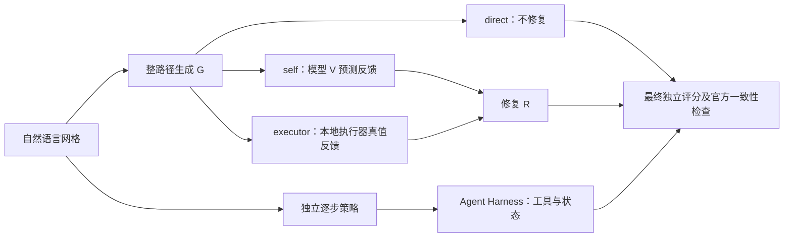

# Project 6：PPNL 网格路径规划项目整理

本文整理仓库中已经实现、运行和归档的 PPNL 单目标研究。阅读时先确定**实验版本、数据划分、模型和调用预算**：早期课程主线、后续三模型实验和单独的约束解码研究使用不同协议，成绩不能拼成一张“模型排行榜”。课程中文说明提供研究范围；下述实现语义与数字以[执行器](../ppnl/core.py)、[评分代码](../ppnl/evaluation.py)和各轮原始记录为准。

**阅读路线：** [数据和错误](#2-数据受控错误与执行器) → [指标及分母](#3-指标定义分母与容易混淆的情形) → [各类 Harness](#4-从课程流程到各类-harness) → [分版本结果](#5-结果逐轮注明模型分母和预算) → [课程要求完成度](#7-按课程要求逐项复核) → [证据与结论边界](#8-证据入口与结论边界)。

## 1. 项目问题与实验版本

任务输入是 6×6 单目标网格的自然语言描述，包含起点、终点和障碍物；模型输出空格分隔的 `up down left right` 动作。系统可先生成整条路径，再验证并修复；另一条研究路线让模型每次选择一个动作，由运行层与执行器交互。项目要分开回答：路径**每步是否合法**、**最终是否到达目标**、**是否达到最短路**，以及错误反馈能否改善这些结果。



图中 G/V/R 是模型任务角色，V 是**模型预测的验证反馈**，不是执行器，也不是评分器。`executor` 分支直接取得执行器反馈，跳过 V；两种反馈都可以作为 R 的输入。最终评分与流程中用于决策的反馈要分开记录。LoRA 是可选训练方式；Agent Harness 控制工具和预算，Evaluation Harness 对输出批量评分。

| 版本 | 模型与方法 | 正确阅读方式 |
| --- | --- | --- |
| 早期课程主线 | Flan-T5-small 与 BART-base 共享多任务全量微调；开发集选择 Flan-T5-small，比较直接生成、自验证、执行器单轮和三轮修复 | [README 正式实验](../README.md#正式实验已完成)；这是课程核心的生成—验证—修复研究。 |
| 独立 G／V／R | G 全量训练，V/R 为独立 LoRA；后有任务指标选模候选 | [原 GVR 实跑](gvr_gpu_run.md)、[后续候选](gvr_next_run.md)；权重与控制器版本均不同于早期共享模型。 |
| Agent 与评测 Harness | 逐步策略、整路径提案、失败后切换策略、前缀续写，以及统一评测注册表 | [Agent Harness](harness.md)、[方法索引](../methods/README.md)；运行控制、模型训练和评测是不同层。 |
| 三模型 GPU 扩展 | 普通 T5-small、T5-base、BART-base；全量基线、GVR、RL、逐步策略、前缀消融 | [实验记录](gpu_campaign_20261103.md)、[机器可读结果](gpu_campaign_results.json)；普通 T5 不是早期 Flan-T5 checkpoint。 |
| 独立约束解码研究 | 历史 Flan-T5 权重上的 C4/B4/U4/H4 修复控制 | [分支实验报告](gvr_repair_study/README.md)标记为未合并研究；不可写成当前默认方法。 |

## 2. 数据、受控错误与执行器

项目从固定版本的官方单目标 6×6 数据构造训练、开发和测试，按**障碍物布局**分组，避免同一布局跨训练／测试。派生数据是训练 **4,000** 条（生成 800、验证 2,000、修复 1,200），开发 **200** 条（40／100／60），ID 与 OOD 测试各 **200** 条。[数据说明](../data/README.md)给出来源和 manifest；[实验协议](experiment_protocol.md)说明筛选、采样与隔离。ID/OOD 使用配对的网格、起点和终点；差异在预置候选的错误数量，不是 6×6 与 7×7 的比较。

### 2.1 注入操作与执行失败是两套分类

生成无效候选时，会对有效路径进行**动作替换、删除、插入、提前停止、未知动作词**等受控操作。提前停止按一次截断操作记录，即使删掉多步。OOD 无效候选在两个原始位置独立注入操作，并要求最终 token 编辑距离为 2；测试中还保留合法控制样本，供验证 Macro-F1 计算。[实验协议](experiment_protocol.md#数据和错误)记录了构造规则。

执行器只报告沿路径观察到的**第一个失败**，所以“注入了两个错误”不表示会得到两个失败标签；不同操作也可能归为同一个执行失败类型。成功路径包括最短路和合法绕路，绕路不是无效样本。负例若操作后仍成功会重采样。不要把“替换／删除”当作验证器要预测的 `reason`。

| 执行器 `reason` | 判定条件 | `feasible` | 首错位置 |
| --- | --- | --- | --- |
| `invalid_action_token` | 当前 token 不在四个动作词中，如 `jump` | false | 该 token 的 1-based 步号 |
| `out_of_bounds` | 当前动作走出网格边界 | false | 越界动作的步号 |
| `obstacle_collision` | 当前动作进入障碍格 | false | 碰撞动作的步号 |
| `goal_not_reached` | 所有动作合法，但**最后位置**不是目标 | true | 动作数 + 1，即 `<eos>` |
| 无失败 | 所有动作合法，最后位置是目标 | true | 无；验证标签为 `valid` |

空路径且起点不等于目标时，失败位置是第 1 步的 EOS。若后面的 token 非法，但前面已先撞墙，以更早的物理失败为准。严格的非法 token 检查是本项目本地执行器的扩展：官方 `is_goal` 会忽略未知词；合法动作的成功和碰撞结果再与固定哈希的官方执行器交叉核对。[实现](../ppnl/core.py)定义了具体顺序。

## 3. 指标：定义、分母与容易混淆的情形

设一次评测包含 `N` 条最终路径，网格的 BFS 最短动作数为 `L*`，输出动作数为 `L`。[评分函数](../ppnl/evaluation.py)逐条执行，再取样本平均。

| 指标 | 计算方法与分母 | 解读 |
| --- | --- | --- |
| Success rate | `合法且最后在目标的路径数 / N` | 中途路过目标、最后又离开，仍算失败。 |
| Feasibility | `整条路径动作合法且无越界／碰撞的路径数 / N` | 不要求到达目标；`goal_not_reached` 也计入可行。 |
| Optimality | `成功且 L = L* 的路径数 / N` | 分母是**所有路径**，所以最优率不会高于成功率。 |
| Path efficiency on success | 成功样本上 `L* / L` 的平均 | **只在成功样本上**计算；没有成功样本时为 `null`，不是 0%。 |
| Repair success rate | 修复后成功的金标**无效候选数 / 全部金标无效候选数** | 使用预置候选，不等于从零生成成功率。 |
| End-to-end success | 完整流程最终成功的**唯一网格／起点／终点数 / 参与流程的环境数** | 从模型自己生成的首条路径开始；不能混入固定候选修复。 |

以无障碍 3×3 网格、起点 `(0,0)`、目标 `(0,2)` 为例，最短路长度为 2：`right` 合法但未到目标，feasibility=1、success=0；`right right` 三项均为 1；`down right right up` 合法且到目标，feasibility=1、success=1、optimality=0，成功样本路径效率为 `2/4=0.5`；`jump right right` 在第 1 步失败，feasibility=0。若四条各评一次，整体 success=50%、feasibility=75%、optimality=25%，只在两条成功路径上的平均效率为 75%。这些是指标示例，不是模型实验结果。

验证任务的金标是 `valid` 或 `invalid | step=<1-based index> | reason=<上述类型>`。**Format accuracy** 是能按该语法解析的输出比例；**Macro-F1** 固定计算 valid 与 invalid 两类 F1 的平均，格式不合法的输出计为对应真类的漏报，不剔除样本。**首错定位准确率**以全部金标无效候选为分母，要求预测 `invalid` 且步号正确；**错误类型准确率**还检查 `reason`，**首错联合准确率**要求步号与类型同时正确。若 100 条合法和 100 条非法都被预测为 `valid`，格式准确率可达 100%，但 invalid 类 F1 为 0、valid 类 F1 为 2/3，Macro-F1 仅 **1/3**，首错定位为 0。[实现](../ppnl/evaluation.py)在某组无样本时保存 `null`，不凭空填 0。按某一种错误类型筛选后的 Macro-F1 仍固定使用两类，不能和全体 Macro-F1 直接当同口径比较。

**Harness 还有一个额外分母陷阱。** Agent Harness 的 `move` 只有合法移动才写入已提交路径，`submit_plan` 只有整条成功才提交；失败提案仍记在事件日志与 `invalid_calls`。因此“最终已提交路径的可行率 100%”可能只说明运行层拒绝了非法提案，甚至空前缀也可能可行，不能据此说原模型每次输出都合法。应同时看 success、最优率、提案失败数、模型／工具调用数和原始反馈。[Agent Harness 记录](harness.md#与旧基线比较的限制)特别说明了这一点。

## 4. 从课程流程到各类 Harness

“Harness”在仓库里至少指三件不同的事：**整路径 G／V／R 控制器**管理生成、验证和修复；**Agent Harness**持有环境状态并执行受限工具调用；**Evaluation Harness**按同一执行器批量运行不同规划器、对照冻结指标。它们可以调用同一模型，但不能把一个运行层的结果当成另一个的复现实验。

### 4.1 V、执行器、R 和金标的实际数据流

同一个 `invalid | step=… | reason=…` 字符串可以来自不同来源，**来源决定实验含义**。这里的“官方执行器”只提供 `is_goal` 成功／碰撞语义核对；[本地严格执行器](../ppnl/core.py)逐 token 执行，产生四类 `reason`、首错步和 `feasible`，并作为数据集 `label`、执行器分支反馈的实际来源。对合法动作，`OfficialOracle.check()` 比较官方与本地结果；非法或粘连动作的严格拒绝是项目扩展，不能声称四类诊断均由官方 `is_goal` 原生给出。

| 场景 | V 是否被调用 | 交给 R 的反馈 | 结果能证明什么 |
| --- | --- | --- | --- |
| 固定候选的独立验证测试 | 是，对预置候选预测 | 此测试不调用 R | 验证 Macro-F1、首错定位等 V 指标。 |
| 固定候选的独立单轮修复测试 | V 的预测另行记录，**不传入 R** | 数据行 `label`，即执行器金标 | **给定正确诊断时** R 修复预置坏路径的能力；不证明 V→R 串联有效。 |
| `direct` 从零生成 | 否 | 无；不修复 | G 独立规划能力。 |
| `self` 从零生成 | 是，对 G 输出预测 | V 原始预测文本；解析为 `valid` 时跳过 R，否则修复一次 | V 误判 `valid` 会把失败路径放行；格式错误反馈仍会传给 R。真值只在最终评分时使用。 |
| `executor_one`／`executor_three` | **否** | 对当前 G/R 候选重新执行得到的金标；最多修复一／三次 | 执行器引导的 R 效果；不能归功于 V。 |
| Agent 工具 `verify_plan` | 否 | 对工具传入的候选运行确定性执行检查 | 工具反馈，不是学习式 V 的预测，也不提交路径。 |

[`ppnl/evaluation.py`](../ppnl/evaluation.py)第 65–72 行与[`ppnl/gvr_evaluation.py`](../ppnl/gvr_evaluation.py)第 78–86 行都将固定候选 `row["label"]` 传给 R，V 预测另算。GVR 的 `candidate_traces.jsonl` 虽同时有 `gold_feedback` 和 `model_feedback` 字段，也不能据此认定 R 使用了模型反馈；分任务候选 ID 未必重合，`model_feedback` 还可能为空。只有端到端 `self` 才测试 V→R 的实际串联。V 在早期主线是共享多任务 checkpoint 的验证任务，在独立 GVR 实验中才是单独的 V adapter；二者名称相同，模型结构不同。

### 4.2 早期课程流程：直接、自验证、执行器反馈

[`ppnl/evaluation.py`](../ppnl/evaluation.py)先在固定候选上**分别**评测验证与金标反馈下的修复，再按唯一规划环境从零生成。完整流程包含：`direct` 只生成；`self` 让模型验证生成路径，反馈解析为 `valid` 才跳过一次修复；`executor_one` 将本地严格执行器首错反馈给模型修复一次；`executor_three` 最多重复三轮，每轮重新执行当前候选，只对失败者继续修复。第一轮结果同时是“去掉重复修复”的消融。`self` 的执行真值只在**最终计分**时使用，不回灌决策；执行器分支则在每轮决策前调用执行器。多轮流程消耗更多推理，不是同预算对照。[实验协议](experiment_protocol.md#改进与消融)说明了选择与限制。

### 4.3 G／V／R Harness：阶段状态机和独立评分

[`ppnl/gvr_harness.py`](../ppnl/gvr_harness.py)把上述四种模式实现为可恢复的阶段状态机：`generate → feedback → decide → repair → feedback`，`direct` 在 G 后直接停止。`self` 的 `feedback` 阶段调用模型的 `verification` 任务；执行器模式的同名阶段直接调用 `execute(grid, candidate).label()`，不请求 V。`decide` 解析当前反馈，预测 `valid` 就停止，否则在预算内交 R；R 输出新候选后再进入反馈。控制器保留原始反馈与 `feedback_source`，遇到重复候选会停止；错误的模型 `valid` 可以导致错误放行，因此最终独立计分时另记 `false_valid_accept`，它**只统计模型反馈导致的错误放行**。`score_gvr_session` 在流程停止后调用 `OfficialOracle.check()` 复核最终候选，不回灌自验证决策。每次模型请求先写日志并计入预算，运行可恢复；模型、底座、adapter 身份变化会拒绝续跑。

同一控制器可接两类后端：[`full_finetune_gvr.py`](../ppnl/full_finetune_gvr.py)使用已有全量多任务 checkpoint，只改变推理控制、不重训或使用 LoRA；[独立 GVR LoRA](gvr_protocol.md)则先用 **800 条生成样本**训练 G，再在冻结 G 上分别用 **2,000 条验证**和 **1,200 条修复**样本训练 V/R 的独立注意力 LoRA adapter。三阶段共用固定数据索引，不能把它说成三个模型各用了 4,000 条。二者同时改变模型来源与训练结构时，不能把成绩差异归因于控制器或 LoRA 单一因素。独立 GVR 的开发集为生成 40、验证 100、修复 60；原历史评测的开发配额已按保存的预测重算，[原记录](gvr_gpu_run.md)和[后续候选](gvr_next_run.md)分别列数值。

### 4.4 Agent Harness：工具边界、状态与可恢复性

[`ppnl/harness.py`](../ppnl/harness.py)让后端每轮提出一个受限调用，Harness 独占网格状态和评分。当前代码工具白名单有 **5 个**（早期[说明](harness.md#新运行层)写 4 个，后来增加 `submit_prefix_plan`）：

| 工具 | 对环境的作用 | 成功条件和失败处理 |
| --- | --- | --- |
| `move(action)` | 提交一个物理合法动作，更新已提交路径 | 非法动作或碰撞只返回反馈，不移动；到达目标自动成功。 |
| `verify_plan(plan)` | 执行检查并返回反馈 | 只看候选，不提交路径。 |
| `submit_plan(plan)` | 提交一整条路径 | 只有整条执行成功才写入已提交路径；失败候选留下反馈。 |
| `submit_prefix_plan(plan)` | 从空已提交路径出发，保留候选实际走通的合法前缀 | 停在首错前或目标处；把失败位置与保留前缀记录下来，供逐步续写。 |
| `finish()` | 主动停止 | 本身不能宣称到达目标。 |

运行层不给模型 shell、网络、文件写入或任意 Python 工具；Flan-T5/BART 也不原生调用工具，[`harness_backends.py`](../ppnl/harness_backends.py)负责把模型输出封装为工具请求。单个 trial 有模型调用、工具调用、动作尝试总数、单提案长度、上下文事件数和活动耗时预算。模型调用先记账再推理；已提交动作写入追加式哈希链日志，`state.json` 只是可重建快照。文件锁防止同一 trial 并发写入，恢复时检查配置、权重、代码及执行器身份。崩溃后模型调用可能重试，已提交动作不会重放；活动时间在调用边界检查，不能抢占正在阻塞的生成。[设计与限制](harness.md#新运行层)给出实现细节。

### 4.5 后端设计：逐步、整路径、切换和前缀

| 后端／约束 | 每轮做什么 | 额外模型或规则 |
| --- | --- | --- |
| `repair` | 首轮生成整路径；失败后依据执行器反馈重新生成整路径 | 原整路径模型；失败提案不会偷偷改变实际位置。 |
| `policy` | 在当前真实位置给四动作评分，选一步并调用 `move` | 独立训练的逐步模型；不运行图搜索。 |
| `legal_mask` | 只在当前物理合法邻居中挑动作 | 确定性动作过滤；不等于模型自己避免撞墙。 |
| `avoid_revisits` / `harness_visit` | 在合法邻居中先取访问次数最少者，再用神经评分打破并列 | 必要时仍可回访；不同于“禁止所有已访问格”的 `legal_no_revisit`。 |
| `repair_policy` | 整路径最多两次提案；仍失败就从真实已提交位置切换逐步策略 | 增加第二个已训练模型；两阶段共用总预算。 |
| `prefix_state_repair` | 整路径一次提案后用 `submit_prefix_plan` 留下实际合法前缀，再由逐步策略续写 | 不保留首个失败动作及其后缀；初始提案与续写模型要分开归因。 |

上述切换条件取自持久化状态，恢复后不会重新获得两次整路径额度。[配置索引](../configs/README.md)与[Agent Harness 记录](harness.md)说明配对预算。三模型扩展的非搜索策略统一最多 **36 步**；早期单 trial Agent Harness 配对研究统一最多 **16 次模型／工具调用**。这两个预算不是同一量纲，不能用 36 步实验的 100% 直接替代 16 次调用实验的 99.5%。

### 4.6 Evaluation Harness：方法注册与冻结比较

[`ppnl/eval_harness.py`](../ppnl/eval_harness.py)和[`scripts/run_eval_harness.py`](../scripts/run_eval_harness.py)是**批量评测层**，不是上面的工具交互运行层。它对同一组网格注册 `state_policy`（裸逐步）、`legal_mask_no_search`（合法且未访问动作约束）、`neural_best_first`、`symbolic_astar_no_model`、`neural_optimal_astar`（神经分数只做相同 `g+h` 的并列排序）与强纯 A* 对照；还可用已归档整路径 trace 作为 `original_whole_plan`。相同 `plan_metrics` 用于最终路径与候选合法前缀修复。评测输出 JSON、Markdown/HTML 报告和逐条轨迹，并与冻结指标逐字段比较；权重及官方执行器哈希不符会报错。历史统一评测在 **dev 98 个去重网格、ID/OOD 各 200 个**上与冻结数值 **0 个字段不符**。[评测说明](harness.md)同时提醒：跨 split 共享评分缓存的耗时只是增量耗时，不是严格冷启动速度对照。

## 5. 结果：逐轮注明模型、分母和预算

### 5.1 早期课程主线：反馈没有救回从零生成

两模型用同一批 4,000 条多任务数据、同样两轮训练，在相同 ID 测试上比较；按开发集综合分数 **0.2897 对 0.2374** 选 Flan-T5-small 为主模型。表中验证指标来自固定候选；修复成功率以无效候选为分母；端到端以规划环境为分母。[正式记录](../README.md#正式实验已完成)保留配置与原始输出。

| 模型／划分 | 验证 Macro-F1 | 首错定位 | 一次固定候选修复 | 从零直接生成 | 完整端到端 |
| --- | ---: | ---: | ---: | ---: | ---: |
| Flan-T5-small，ID | 0.7141 | 8% | 19% | 0/200 | 0% |
| BART-base，ID | 0.7246 | 45% | 10% | 0/200 | 未作为主模型展开 |
| Flan-T5-small，OOD 双错误 | 0.7700 | 20% | 7% | 同一批规划网格 | 0% |

主模型 OOD 固定候选在最多三轮反馈后修复成功率 **11%**，一次为 **7%**；ID 一次和三轮均 **19%**。这表明部分已知错误路径可修，但没有证明系统能从零规划。早期两个模型的 ID 直接生成均失败，模型 loss 下降也不能代替执行成功。[原实验协议](experiment_protocol.md#改进与消融)明确多轮方案使用更多推理计算。

同一 ID 固定候选的**一次修复**中，Flan-T5-small 的 feasibility 为 **46%**、optimality 为 **19%**；BART-base 分别为 **34%**、**10%**。[README 原始记录](../README.md#正式实验已完成)将它们与修复成功率并列保存。这里最优率恰好等于成功率，只描述这一批修复输出；不能据此推断所有成功路径都最短。

课程要求的三项路径指标要按**输出集合**分别看。下面直接复核归档的[主模型 ID 指标](../artifacts/historical_models/flan_t5_small/eval_test_id_full/metrics.json)与[OOD 指标](../artifacts/historical_models/flan_t5_small/eval_test_ood_full/metrics.json)；每个单元格依次为 `success / feasibility / optimality`，固定候选修复分母是 **100 条金标无效候选**，从零流程分母是 **200 个环境**：

| 输出集合 | ID | OOD |
| --- | --- | --- |
| 固定候选＋金标反馈，R 一次 | 19% / 46% / 19% | 7% / 45% / 7% |
| 固定候选＋执行器反馈，R 最多三次 | 19% / 31% / 19% | 11% / 25% / 11% |
| 从零 `direct`、`self`、`executor_one`、`executor_three` 各自最终路径 | 四种模式均 0% / 0% / 0% | 四种模式均 0% / 0% / 0% |

OOD 固定候选三轮修复比一次多成功 **4/100**，可行率却从 45% 降到 25%；可见继续修复也可能破坏原先合法但未到目标的路径。ID/OOD 从零流程使用配对的相同规划环境，上表两列不能合并为 400 个独立生成样本。

### 5.2 独立 G／V／R LoRA：分类改善不等于流程成功

[首轮 GVR 实跑](gvr_gpu_run.md)在修正后的开发配额上：验证 100 条，Macro-F1 **0.3333**；无效候选修复 60 条，成功 **7/60**；生成 40 个网格，四种流程均 **0%**。验证器对固定候选全部回答 `valid`，难以诊断失败。ID/OOD 每组 200 条验证候选、其中 100 条金标无效用于修复：

原首轮 GVR 的 ID/OOD 四种端到端流程不仅 success 为 0，记录中的最终路径 feasibility 和 optimality 也均为 **0%**。[原实跑记录](gvr_gpu_run.md#实测结果)可见每个模式的模型与执行器平均调用数；不能把候选修复的 12%／6% 混入这些端到端指标。

| GVR 版本／划分 | 验证 Macro-F1 | 首错定位 | 无效候选修复 | `direct/self/executor_one/executor_three` 端到端 |
| --- | ---: | ---: | ---: | ---: |
| 首轮，ID | 0.3333 | 0% | 12/100 | 均 0/200 |
| 首轮，OOD | 0.3333 | 0% | 6/100 | 均 0/200 |
| [后续候选](gvr_next_run.md)，ID | 0.6499 | 10% | 12/100 | 均 0/200 |
| 后续候选，OOD | 0.7326 | 4% | 4/100 | 均 0/200 |

后续候选通过任务指标选模，把开发集验证 Macro-F1 提高到 **0.6624**、修复提高到 **9/60（15%）**，但 ID 修复未提高，OOD 修复反而从 6 降到 4；其自验证在 ID 的 **200/200** 个生成失败样本上错误放行。四种流程仍没有端到端成功。这是“验证器会输出正确格式或较高 F1”仍不等于“会纠正生成路径”的直接例子。首轮运行早于后来的控制器修复，CPU 重算没有重新推理；不同版本的权重、控制器和开发选择不能混作单变量消融。

### 5.3 Agent Harness：同预算的恢复、访问约束消融

[Agent Harness 实验](harness.md)先在开发集前 20 个去重网格配对比较，全部方法最多 16 次模型／工具调用：只用整路径反馈修复 **0/20**，平均 16 次调用；两次整路径失败后切换逐步策略 **20/20**，平均 7.5 次；直接逐步策略加相同约束也是 **20/20**，平均 5.5 次。后两者最优率均 80%。开发集的 20/20 不能外推为完整测试集 100%。

完整 ID 比较使用**相同 200 个网格、16 次调用上限和同一逐步模型权重**，结果如下：

| Agent 运行方式 | Success | Optimality | 平均模型调用 | 主要差异 |
| --- | ---: | ---: | ---: | --- |
| 逐步策略＋合法动作过滤，无访问约束 | 170/200（85%） | 未在该配对报告单列 | 6.025 | 可走回已访问格，神经分数决定选择。 |
| 逐步策略＋最少访问次数约束 | 199/200（99.5%） | 86.5% | 5.025 | 在合法邻居中优先访问次数最少者；相对上行多成功 29/200。 |
| 先两次整路径提案，再逐步恢复 | 198/200（99%） | 86.5% | 7.01 | 两次失败提案占用预算，比直接逐步少成功 1 个网格。 |

第二行相对第一行提高 **14.5 个百分点**，属于运行约束和流程改进，**没有重新训练整路径 checkpoint**。配对开发集显示“先整路径再恢复”没有优于直接逐步；完整 ID 也支持这个判断。运行层拒绝不合法提案，表中的 success 和 optimality针对已提交路径；单看最终 feasibility 无法审计原始提案是否有效，需看 `mean_invalid_calls` 与事件日志。早期 `legal_mask_no_search` 是**禁止已访问格**的另一个算法，预算也不同，不能替换本表的无访问约束基线。

### 5.4 三模型扩展：整路径、逐步策略和搜索分开看

[三模型实验](gpu_campaign_20261103.md)按 200 个 ID 环境评价 `direct/self/executor_one/executor_three`，下表为**整路径全量多任务基线**的成功数。其余 GVR vanilla／structured 模式、验证损失和 RL 消融在原报告中保留，不能只摘取最好的行。

| 模型 | Direct | Self | Executor 1 | Executor 3 | Direct feasibility | Executor 3 feasibility |
| --- | ---: | ---: | ---: | ---: | ---: | ---: |
| 普通 T5-small | 2/200 | 2/200 | 4/200 | 4/200 | 19% | 21% |
| 普通 T5-base | 3/200 | 2/200 | 6/200 | 7/200 | 33% | 28% |
| BART-base | 0/200 | 0/200 | 0/200 | 0/200 | 7% | 2% |

这组整路径结果中，Direct 和 Executor 3 的成功路径刚好均为最短路，因此相应 optimality 与 success 相同；**不能推广为“成功必然最优”**。T5-base 的三轮反馈虽然比直接生成多成功 4 个环境，可行率却从 33% 降到 28%，说明指标会朝不同方向变化。[结果 JSON](gpu_campaign_results.json)保存了全部模式的 feasibility、optimality、耗时与调用数。

三模型**独立逐步策略**在相同 200 个 ID 网格上的完整指标如下，均按最多 36 步评价；表内百分比来自[机器可读结果](gpu_campaign_results.json)：

| 模型 | 策略／约束 | Success | Feasibility | Optimality |
| --- | --- | ---: | ---: | ---: |
| T5-small | raw 裸逐步 | 84.5% | 97% | 84.5% |
| T5-small | legal_no_revisit 禁止回访 | 97.5% | 100% | 86% |
| T5-small | harness_legal 仅合法动作 | 85% | 100% | 85% |
| T5-small | harness_visit 最少访问次数 | 100% | 100% | 86% |
| T5-base | raw 裸逐步 | 81.5% | 100% | 81.5% |
| T5-base | legal_no_revisit 禁止回访 | 96% | 100% | 85% |
| T5-base | harness_legal 仅合法动作 | 81.5% | 100% | 81.5% |
| T5-base | harness_visit 最少访问次数 | 100% | 100% | 85% |
| BART-base | raw 裸逐步 | 82% | 90% | 78% |
| BART-base | legal_no_revisit 禁止回访 | 95% | 100% | 82.5% |
| BART-base | harness_legal 仅合法动作 | 84.5% | 100% | 80% |
| BART-base | harness_visit 最少访问次数 | 100% | 100% | 82.5% |

`harness_legal` 的可行率全为 100%，但 T5-small 的成功率仍只有 85%：合法动作序列可以绕路、重复访问或在预算内停在目标外。`harness_visit` 进一步减少无效循环，使三个模型在本测试集均到达目标；最优率仍只有 82.5%–86%，说明多数改善来自**到达率**，并非最短路质量。纯 A* 也为 200/200 且最优率 100%；神经分数只作 A* 并列排序的版本同样 100%／100%，最优性来自显式搜索规则，不能写成模型独立学会最短路。T5-small 的开发集预选为更简单的 `legal_no_revisit`，虽然测试中的 `harness_visit` 为 200/200，也不能用测试成绩倒改开发选择。

### 5.5 前缀修复：成功率与路径质量分离

前缀方法先实际执行整路径候选，**保留首错前已合法移动的前缀**，再让独立逐步策略从当前真实位置补全；`restart_visit` 对照则完全丢弃前缀，从原起点调用相同策略。[方法地图](project_map.md#前缀评估的规范入口)与[三模型记录](gpu_campaign_20261103.md#前缀修复成功率高但保留绕路会损害最优率)说明它不是让原 G 模型突然具备修复能力。

三模型各有全量、vanilla GVR、structured GVR 三种生成来源，共九种前缀来源；在 `prefix_visit` 下 ID 测试**全部 200/200 成功**，但最优率只有 **27.5%–37%**。丢弃前缀的 `restart_visit` 同样全部 200/200 成功，最优率依模型为 **86%／85%／82.5%**；纯启发式前缀对照也全部成功。由此，高成功率主要来自后续策略与约束，保留原路径绕路会伤害 optimality。原始合法前缀、实际保留前缀、重启对照及动作预算在结果中分别记录，不应把前缀 200/200 解释为原整路径生成 200/200。

### 5.6 独立约束解码研究：提高成功率仍需强规则对照

[约束解码研究报告](gvr_repair_study/README.md)说明这项结果位于未合并的 `gvr-constrained-repair-study` 研究分支，使用历史 Flan-T5-small 权重而**没有新训练**。C4 只在**执行器反馈分支的 R 解码**使用宽度 4 的 beam、最多 36 个动作、合法移动和位置去重；G 和 V 仍沿用旧解码，C4 的提升不能归因于 V 改善。B4 保留相同模型和 beam 但关闭执行状态约束；U4/H4 分别用固定动作顺序／曼哈顿距离替代模型评分。它们比较的是推理控制，不能混入上面的三模型训练结果。

| 方法 | ID 端到端 Success（200 环境） | Feasibility | Optimality | 固定候选 ID／OOD 修复 |
| --- | ---: | ---: | ---: | ---: |
| 原 direct／self／E1／E3 | 全部 0/200 | 未在该对照表单列 | 0% | E1 为 19/100／7/100 |
| B4：同宽度、仅动作语法 | 0/200 | 未在该对照表单列 | 0% | 25/100／8/100 |
| C4：执行状态约束 | **184/200（92%）** | **100%** | **43%** | **98/100／94/100** |
| U4：固定规则排序 | 191/200（95.5%） | 未在该对照表单列 | 37% | 95/100／95/100 |
| H4：曼哈顿规则排序 | **200/200（100%）** | 由成功率可知 100% | **99.5%** | **100/100／100/100** |

C4 的 100% feasibility 包含 **16 条合法却未到目标**的失败路径，不能替代 92% success；43% optimality 又说明许多成功路径绕路。H4 的成功率和最优率都更高，故不能声称语言模型排序是成功所必需。这项测试与历史 ID/OOD 使用相同生成环境，OOD 仅换候选错误分布；报告标为重复测试上的探索性研究，且该分支代码未并入默认入口。

## 6. 按错误类型看失败与具体轨迹

“什么操作制造了坏候选”和“最终执行器报告什么失败”应分表保存；评测按**实际首错 reason**分组。先看课程主模型 Flan-T5-small 的[ID](../artifacts/historical_models/flan_t5_small/eval_test_id_full/metrics.json)／[OOD](../artifacts/historical_models/flan_t5_small/eval_test_ood_full/metrics.json)原始指标。定位正确数以该首错类全部金标无效候选为分母；修复成功数是**金标反馈下的一次 R**，不是 V 预测反馈的串联效果：

| 金标首错 | ID 数量 | ID 定位正确 | ID 一次修复成功 | OOD 数量 | OOD 定位正确 | OOD 一次修复成功 |
| --- | ---: | ---: | ---: | ---: | ---: | ---: |
| `goal_not_reached` | 58 | 7/58 | 10/58 | 30 | 4/30 | 0/30 |
| `invalid_action_token` | 20 | 1/20 | 6/20 | 45 | 13/45 | 4/45 |
| `obstacle_collision` | 14 | 0/14 | 1/14 | 14 | 3/14 | 2/14 |
| `out_of_bounds` | 8 | 0/8 | 2/8 | 11 | 0/11 | 1/11 |

ID 的 `obstacle_collision` 和 `out_of_bounds` 定位均为 0；OOD 的 `goal_not_reached` 一次修复为 0/30。这些是比总 Macro-F1 更直接的错误诊断盲点。两组另各有 100 条合法控制，供有效／无效分类计分，不属于上表修复分母。

以下两例直接取自早期主模型的[ID 案例归档](../artifacts/historical_models/flan_t5_small/eval_test_id_full/case_studies.json)。坐标为 `(行,列)`、从 0 开始；完整网格由 6×6 尺寸、起终点及**全部障碍坐标**确定。表中的 V 预测是旁路测试输出；列出的固定候选 R 实际收到的是执行器金标。

**案例 A：错误定位偏早，金标反馈修复又引入越界（`test_id-1`）。** 起点 `(3,4)`、目标 `(2,5)`、障碍 `(2,1),(2,2),(3,2)`；BFS 最短路 `up right`，2 步。预置候选 `down right` 依次到 `(4,4)`、`(4,5)`，随后在 `<eos>` 第 3 步发现未到目标，故 `feasible=1, success=0, optimality=0`。V 却预测 `invalid | step=2 | reason=goal_not_reached`，位置错误。R 在**金标** `invalid | step=3 | reason=goal_not_reached` 下第 1 轮输出 `down right right right`：前两步后从 `(4,5)` 再向右，**第 3 步越界**。第 2 轮改为 `down right right right right`，第 3 轮改为 `down right right right right right right`，两次仍在第 3 步越界；三轮最终 `feasible=0, success=0, optimality=0`。这例说明反馈正确也不能保证 R 避免新错误，更不能凭固定候选结果判断 V→R 有效。

**案例 B：V 定位仍偏早，但金标反馈下一轮修复成功（`test_id-7`）。** 起点 `(3,4)`、目标 `(3,2)`、障碍 `(0,1),(1,1),(2,3),(3,0),(5,2)`；BFS 最短路 `left left`，2 步。预置候选 `left` 到 `(3,3)` 后停止，金标为 `invalid | step=2 | reason=goal_not_reached`，候选 `feasible=1, success=0, optimality=0`。V 预测 `invalid | step=1 | reason=goal_not_reached`，首错位置不对。R 收到**金标**，第 1 轮输出 `left left`，从 `(3,4)` 经 `(3,3)` 到 `(3,2)`；执行器回 `valid`，停止后 `feasible=1, success=1, optimality=1`。这只能证明给定正确反馈的候选修复成功；不能把 V 的错误诊断当作 R 的实际输入。

再看[三模型结果 JSON](gpu_campaign_results.json)中的普通 T5-small 全量多任务基线、ID 固定候选。它同样有 100 条合法控制与 100 条无效候选；下表是**三模型扩展的 T5-small**，不是早期 Flan-T5-small：

| 金标首错类型 | 无效候选数 | 一次修复成功 | 反映的问题 |
| --- | ---: | ---: | --- |
| `goal_not_reached` | 58 | 8/58 | 路径每步合法，却停在目标外；高 feasibility 不能掩盖失败。 |
| `invalid_action_token` | 20 | 4/20 | 输出不在四动作词表；要先检查格式与严格 token 解析。 |
| `obstacle_collision` | 14 | 1/14 | 走进障碍格；首错后的路径不再被执行。 |
| `out_of_bounds` | 8 | 1/8 | 走出边界；执行器在该步停止。 |

两条[后续 GVR 候选修复案例](gvr_next_run.md#真实候选修复案例)说明反馈格式的实际作用：`test_id-7` 原候选 `left`，反馈为 `invalid | step=2 | reason=goal_not_reached`，修复成 `left left`；`test_id-19` 原候选 `left left jump`，反馈为第 3 步 `invalid_action_token`，修复成 `left left left`。执行器确认修复成功，但这两例均从**给定候选**开始，不能用来证明端到端生成成功。

[约束解码研究](gvr_repair_study/README.md#五-两个具体案例)还给出两种相反的系统失败：一条原生成在第 4 步越界，C4 修复后虽合法到达，却走了 **24 步**，强规则 H4 只需 **4 步**；另一条 C4 给出 **25 步合法前缀**却停在目标外，形成 `dead_end`，而 H4 用 5 步到达。前者是 success=1、feasibility=1、optimality=0，后者是 success=0、feasibility=1、optimality=0。这比只报一个成功率更能说明约束对合法性与路径质量的不同影响。

## 7. 按课程要求逐项复核

以下以用户提供的《Project_6_完整中文翻译.md》为**要求清单**，对照本仓库代码和已归档记录；该文件描述的是作业目标，不自动证明已经完成。此处的“完成”仅指有实现和实验记录，“报告完成”需另有可提交的书面成稿。2026-11-12 核对结果：**核心实验已运行，全部课程交付尚未完成**。

| 要求 | 核对结果 | 证据和边界 |
| --- | --- | --- |
| 6×6 单目标、官方环境、布局隔离、有效最短／非最短路径和受控单／双错误 | 已实现并记录 | [数据说明](../data/README.md)、[协议](experiment_protocol.md)；官方 `is_goal` 与本地严格诊断的分工见 4.1。OOD 的双错误仅施加于无效候选，合法控制样本仍保留。 |
| 生成 G、验证 V、修复 R；至少两模型同一 ID 基线，开发集选主模型 | 已运行 | [正式基线](../README.md#正式实验已完成)用 Flan-T5-small 与 BART-base，匹配数据和训练预算，开发集选 Flan；固定候选 R 用**金标**反馈，不能当作 V→R 联合成绩。 |
| 直接、自验证、执行器反馈；ID 单错误与 OOD 双错误；改进及聚焦消融 | 已运行，但结论范围有限 | 主线有 `direct/self/executor_one/executor_three`、一轮与三轮对照和 ID/OOD [实验记录](../README.md#正式实验已完成)。重复修复增加推理预算；配对 ID/OOD 的从零规划网格相同，只有候选错误分布不同。后续 C4 属独立、重复使用测试的探索性分支。 |
| 成功率、可行率、最优率、验证 Macro-F1、首错定位和修复成功率，按错误类型分析 | 指标已实现，有分版本原始结果；尚未整合为课程报告 | [评分代码](../ppnl/evaluation.py)、[正式结果索引](../README.md#正式实验已完成)、[GVR 指标](gvr_gpu_run.md)、[三模型结果](gpu_campaign_results.json)；必须给每个数标注固定候选／从零流程、模型版本、分母。`null` 不能写成 0。 |
| 代表性失败的详细执行轨迹和至少两个详细修复案例 | 本整理已补两例；尚未编入正式学术报告 | 上文案例 A/B 取自[主线真实归档](../artifacts/historical_models/flan_t5_small/eval_test_id_full/case_studies.json)，列出完整网格参数、V 与金标、逐轮输出、首错和最终三项指标。它们是**固定候选＋金标反馈**案例；课程报告若要说明 V→R，应另选端到端 `self` 轨迹，并明确反馈来源。 |
| 摘要、引言、相关工作、方法、实验设置、结果、错误分析、消融和结论组成的学术书面报告 | **未完成** | [实验协议](experiment_protocol.md#报告与展示材料)明确记载“尚未撰写学术报告或演示文稿”。本整理文档是仓库导览与复核，不是那份学术报告；相关工作还需核对原论文后引用。 |
| 精确 Flan-T5/T5 checkpoint 的负责人确认 | **负责人确认记录未见** | [主线配置](../config.json)中 Flan-T5-small、BART-base 均为 `user_confirmed: true`、`manager_confirmed: false`；[三模型配置](../configs/campaign_20261103/baselines.json)中普通 T5 亦如此。[C4 研究记录](gvr_repair_study/README.md#六-预算验证和后续工作)也要求正式提交前保留负责人确认。已有用户确认可说明运行授权，不能替代课程原文要求的项目负责人确认。 |
| 资源约束、单 seed、模型预算和复现记录 | 有记录，引用时需限定版本 | [主线 README](../README.md#正式实验已完成)记载 seed 42、两轮训练和共用账本；[C4 记录](gvr_repair_study/README.md#六-预算验证和后续工作)记载累计 7.1049 GPU 小时。该累计包含不同阶段及独立研究，不能视为单次模型训练时长。 |

7×7／更密网格、额外随机种子、第二模型的完整改进实验属于课程文件中的**可选项**；没有实施不算必做遗漏。CoT/ReAct 等列于相关工作或可选方法，不等于必须实现为本仓库后端。最需要补齐的交付是**学术报告正文（纳入至少两例案例）、负责人对精确 checkpoint 的确认记录**；不能仅凭现有多轮实验和这份整理称“项目全部完成”。

## 8. 证据入口与结论边界

| 要复核的内容 | 主要入口 |
| --- | --- |
| 数据来源、布局隔离与注入规则 | [数据说明](../data/README.md)、[实验协议](experiment_protocol.md)、[冻结规范](evaluation_freeze.md) |
| 四类执行首错及评分公式 | [`ppnl/core.py`](../ppnl/core.py)、[`ppnl/evaluation.py`](../ppnl/evaluation.py) |
| 早期两模型训练及整路径流程 | [README 正式记录](../README.md#正式实验已完成)、[`scripts/run_study.py`](../scripts/run_study.py) |
| GVR 状态机与独立 G／V／R 模型 | [GVR 协议](gvr_protocol.md)、[`ppnl/gvr_harness.py`](../ppnl/gvr_harness.py)、[原／新结果](gvr_gpu_run.md) |
| Agent 工具、后端、日志和 16 次调用配对 | [Agent Harness 说明](harness.md)、[`scripts/run_harness.py`](../scripts/run_harness.py)、[`scripts/compare_harness.py`](../scripts/compare_harness.py) |
| 统一批量评分与三模型 36 步实验 | [Evaluation Harness](../ppnl/eval_harness.py)、[三模型报告](gpu_campaign_20261103.md)、[完整 JSON](gpu_campaign_results.json) |
| 已发布权重、报告和逐条轨迹 | [Git LFS 产物目录](../artifacts/campaign_20261103/README.md)、[历史模型备份](../artifacts/historical_models/README.md) |

在仓库根目录、按[环境说明](environment.md)配置依赖后，可以先在 CPU 上查看方法映射与运行逻辑测试：

```powershell
python -m methods.baseline --describe
python -m unittest discover -s tests -q
```

模型训练／真实推理需 CUDA、对应权重和新的隔离输出目录。新实验应先做开发集选择与冻结，核对模型、数据、执行器、源码及账本身份，再使用测试入口；不能覆盖历史结果或把现有测试改名为新盲测。[方法目录](../methods/README.md)列出各入口和配置。

**目前能支持的结论：** 整路径生成和传统反馈修复的端到端效果较弱；逐步模型配合合法动作与访问约束显著提高这批 6×6 网格的到达率；前缀保留可让路径成功却降低最优率；独立的 C4 约束修复可提升端到端成功，但强规则 H4 仍更好。所有结果要连同样本量、可行率、最优率、调用预算、模型来源和测试复用情况报告。多轮实验主要为单种子、重复使用的探索性测试，现有冻结不能恢复盲测属性。

**与 poster 分开引用：** [poster 对照导览](poster_guide.md)涉及 16k／2k 单任务训练、5×5／7×7 条件和 GPT-5-mini 提示；本仓库的 4,000 条多任务训练与 6×6 配对 ID/OOD 不是那套实验。课程文件中的 Flan-T5 名称与普通 T5 链接也有差异；引用任何百分比时必须写出准确 checkpoint 和实验版本。
